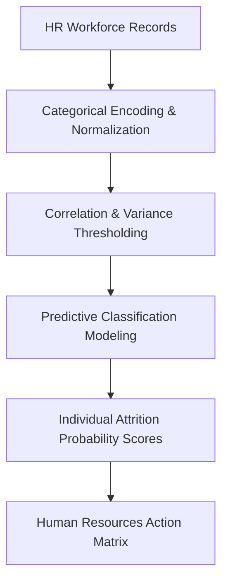

# Employee Attrition Predictive Modeling

> Predictive analytics workflow examining workplace satisfaction, compensation, and retention probability.

[](https://github.com/sohailahmed-bsrh/employee-attrition-analysis)
[](https://sohail.devsil.com/projects.html)
[](https://sohail.devsil.com)

---

## Overview

Unplanned employee attrition costs enterprises thousands per vacancy and disrupts organizational continuity.

This project provides an end-to-end, reproducible implementation engineered to solve this challenge through verified data transformations, robust algorithms, and production-ready architecture.

---

## Key Features

- Exploratory analysis of HR metrics including overtime hours, salary bands, and performance ratings
- Correlation analysis identifying key departure signals
- Binary classification modeling predicting likelihood of employee resignation
- Feature importance analysis detailing actionable workforce retention recommendations

---

## System Architecture



---

## Technology Stack

| Technology | Version / Spec | Role in Architecture |
| :--- | :--- | :--- |
| **Python** | `3.10+` | Data manipulation and scientific computing |
| **Scikit-learn** | `1.3+` | Predictive estimators and model cross-validation |
| **Pandas & NumPy** | `2.0+` | Dataframe aggregation and transformations |
| **Seaborn** | `0.12+` | Correlation heatmaps and demographic bar charts |

---

## Repository Structure

```text
employee-attrition-analysis/
|-- notebooks/
|   `-- Employee Attrition Analysis.ipynb
|-- data/
|-- .gitignore
|-- requirements.txt
`-- README.md
```

---

## Installation and Execution

### Prerequisites
- Python 3.10 or higher
- Git version control
- Virtual environment manager (`venv`)

### Setup Instructions
1. Clone the repository:
```bash
git clone https://github.com/sohailahmed-bsrh/employee-attrition-analysis.git
cd employee-attrition-analysis
```

2. Configure environment and dependencies:
```bash
python -m venv venv
source venv/bin/activate  # On Windows: venv\Scripts\activate
pip install -r requirements.txt
jupyter notebook notebooks/
```

---

## Interface and Verification
The system produces verifiable execution logs, prediction matrices, or interactive browser interfaces depending on the target mode. Verify operation by executing the commands specified above or inspecting the demonstration notebooks.

---

## Author and Contact
Developed by **Sohail Ahmed** — Full Stack AI Engineer & Machine Learning Specialist.
- **Portfolio:** [sohail.devsil.com](https://sohail.devsil.com)
- **GitHub:** [@sohailahmed-bsrh](https://github.com/sohailahmed-bsrh)
- **Email:** [sohail.bsrh@gmail.com](mailto:sohail.bsrh@gmail.com)
